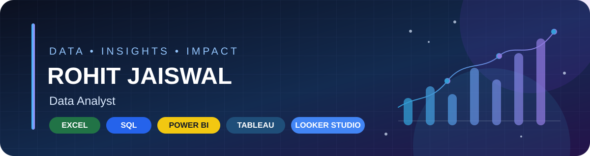

 

---

## 👋 About Me

I'm an aspiring **Data Analyst** who enjoys transforming raw data into clear reports, useful dashboards, and business insights. I have a **B.Sc. in Mathematics (Honors)** and am building practical experience through analytics and reporting projects.

- 🎯 **Target role:** Data Analyst / Junior Data Analyst
- 📍 **Based in:** Prayagraj, Uttar Pradesh, India
- 📚 **Education:** Awadesh Pratap Singh University, Rewa, Madhya Pradesh · 2024
- 💡 **Interested in:** Data analysis, KPI reporting, dashboards, and workflow automation
- 🤝 **Open to:** Data Analyst opportunities

## 🧰 My Tech Stack

### Core Analytics

### Data Visualization

### Generative AI

### Data & Workflow Tools

## 📊 What I Work On

<table>
<tr>
<td width="50%" valign="top">

### 🧹 Data Preparation
- Cleaning and organizing raw datasets
- Checking data quality and consistency
- Preparing structured data for analysis

</td>
<td width="50%" valign="top">

### 📈 Analysis & Reporting
- Exploring sales and profitability trends
- Summarizing KPIs and performance
- Presenting findings through reports and dashboards

</td>
</tr>
<tr>
<td width="50%" valign="top">

### 🧮 SQL & Excel
- Filtering, aggregation, and JOINs
- Spreadsheet formulas and PivotTables
- Business-focused analysis

</td>
<td width="50%" valign="top">

### ⚙️ Workflow Automation
- Google Sheets-based tracking
- Monthly metrics and date comparisons
- Apps Script-generated email reports

</td>
</tr>
</table>

## 🚀 Project Highlights

### 🧾 Retail Sales & Financial Analytics Application
**AppSheet · Google Sheets · Google Apps Script**

A retail tracking solution designed to organize daily sales and expense transactions and support financial reporting.

- Organizes sales and expense records in structured Google Sheets
- Uses spreadsheet formulas for historical averages and month-over-month/year-over-year comparisons
- Uses time-driven Apps Script triggers to prepare monthly metrics and email reports

### 🛒 Superstore Sales Analysis
**Excel · SQL · Power BI**

An analytics project focused on examining sales and profitability across products, categories, customers, regions, and shipping.

- Data cleaning and preparation
- Sales and profit analysis
- KPI summaries and business reporting
- Dashboard-focused presentation of insights

### 📈 Excel Business Reporting
**Microsoft Excel**

Practice in cleaning datasets, building PivotTables, summarizing KPIs, visualizing trends, and preparing decision-ready reports.

## 📌 Currently Strengthening

| Excel | SQL | Power BI |
|:---:|:---:|:---:|
| Data cleaning & PivotTables | Joins & analytical queries | Dashboards & KPI visuals |

I’m continually improving these skills by working through practical business questions and refining my project documentation.

## 📈 GitHub Activity

 

## 🤝 Let's Connect

---

**Thanks for visiting my profile!**  
*Always learning. Always analysing. Always improving.* ✨

